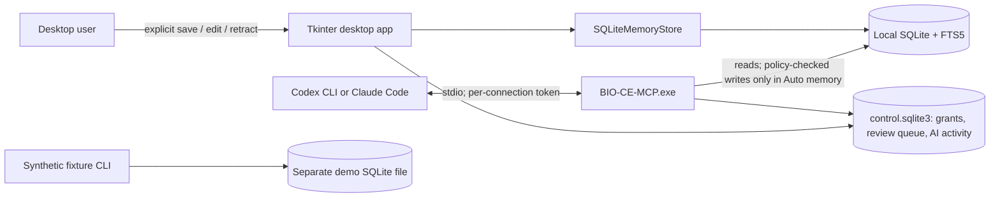

<!-- Copyright 2026 stickleetoto | Apache-2.0 -->
# BIO Community Edition

BIO CE v0.3.0-rc1 is a Windows desktop memory manager backed by a local SQLite/FTS5 store. You add, revise, search, and retract memories yourself. Optional Codex CLI and Claude Code connections use a local stdio MCP server that is **read-only by default**; per host, you can turn on **Auto memory** so the host can also save and update lasting memories under BIO CE's rules.

**Qualification: PARTIAL (release candidate, not a public release).** What has and has not been verified:

| Area | Status |
|---|---|
| Windows version actually exercised | Windows 11 Home x64, build 26200, Korean locale, 100% display scale |
| Automated tests (`pytest -q tests`, official CPython 3.12.10) | 103 passed (also in a fresh clone and venv using the CI workflow's exact steps) |
| v0.3.0-rc1 installer on the developer's own Windows 11 account: v0.2 → v0.3 update, data kept, add/search/edit/retract, backup/restore, Claude Code connection through the installed binaries, Auto memory, recall in a new session, review queue, hook removal, pause, revoke, uninstall/reinstall (silent installs; GUI checked by window capture) | Verified, 25/25 steps (non-clean machine: Python and Git present) |
| v0.2.0-rc1 installer, wizard and CRUD driven through the real GUI | Verified on the developer's account |
| Same flow on a clean Windows 11 VM or account without Python/Git | **NOT VERIFIED** (no VM or Windows Sandbox available; Windows 11 Home) |
| Codex CLI / Claude Code registration, packaged MCP server, official SDK search/read, disconnect | Verified with isolated host profiles |
| A real AI model using Auto memory | Claude Code: saved, deduplicated, corrected, and recalled memories in one short synthetic run. Codex CLI: **limited**, its code-mode models are not shown MCP tools ([Codex support](docs/codex-support.md)) |
| Windows 10, 125%/150% display scaling on real hardware | **NOT VERIFIED** (scaling is covered only by simulated-scale UI tests) |
| GitHub Actions CI on a hosted runner | **NOT PASSED** (the first hosted run on the public repository (2026-10-26) started, so the earlier account billing block no longer applies, but it failed while installing dependencies: the runner's Python ships `pipx`, whose `packaging` requirement conflicts with the lock file, so `pip check` failed. The workflow now installs into its own virtual environment; a hosted run of that fix is pending) |
| Code signing | **Not signed** |

Release gates (source publication and installer pre-release are approved separately): [Public Release Gates](docs/audit/public-release-gates.md). Details and evidence: [release notes](RELEASE_NOTES_v0.3.0-rc1.md), [final RC report](docs/release-v0.3-rc1-final-report.md), [v0.3.0-rc1 stabilization report](docs/release-v0.3-rc1-report.md), [v0.2 test report](docs/release-v0.2-test-report.md), and [v0.2 RC1 release notes](RELEASE_NOTES_v0.2.0-rc1.md).

> **Release candidate (v0.3.0-rc1, branch `feat/autonomous-memory-v0.3`, not published): Auto memory.** A connected
> host can save, update, and recall lasting memories on its own, per host and only after you turn it on. BIO CE's
> server refuses secrets and document-sourced content, sends uncertain changes and every retraction to your review,
> and lets you pause or revoke a host at any time. **Claude Code: available** (verified with a real model).
> **Codex CLI: limited**: Codex's code-mode models are not shown MCP tools ([Codex support](docs/codex-support.md)).
> See [Auto Memory](docs/auto-memory.md) and the [v0.3.0-rc1 report](docs/release-v0.3-rc1-report.md).

## What BIO CE does

- Stores user-entered memories in a per-user SQLite database. Data is written only when you select **Save**.
- Adds explicit revisions, keeps revision history, and uses FTS5 lexical search.
- Offers backup and validated restore in the desktop Settings page.
- Optionally registers a stdio MCP server with Codex CLI or Claude Code after per-host confirmation.
- Gives connected hosts search, read, and history. With **Auto memory** turned on for a host, it can also create and
  update memories; BIO CE refuses secrets and document-sourced content, sends uncertain changes and every
  retraction to your review queue, and lets you pause or revoke a host at any time.
- Runs locally and CPU-first. BIO CE itself does not record conversations, call a model, upload memory, or start a
  network listener. Memories a host reads or writes become part of that host's conversation.

Retraction blocks BIO CE application reads and removes the current row from search. SQLite retains prior revisions, so this is not secure erasure. Database and host-configuration backups are not encrypted.

## Architecture



The installed user database is `%LOCALAPPDATA%\BIO-CE\data\memories.sqlite3`. The synthetic fixture path is `%LOCALAPPDATA%\BIO-CE\demo\demo.sqlite3`; it is separate from the user database. App files install under `%LOCALAPPDATA%\Programs\BIO-CE`, outside the data directory, so updating or removing the app does not remove personal data by default.

## Install and start (Windows 11 x64)

1. Check the download: `Get-FileHash -Algorithm SHA256 .\BIO-CE-Setup-v0.3.0-rc1.exe` must match `SHA256SUMS.txt`.
   The installer is not code-signed, so Windows SmartScreen may show an unknown-publisher warning. BIO CE never
   asks you to turn off SmartScreen or any other Windows protection.
2. Double-click `BIO-CE-Setup-v0.3.0-rc1.exe`. No administrator rights and no Python are needed. The default
   folder is `%LOCALAPPDATA%\Programs\BIO-CE`; you may pick another one (spaces and Korean characters work).
3. Start **BIO CE** from the Start menu (or leave **Start BIO CE** ticked at the end of Setup).
4. Read the first-run data notice. **Continue** creates your data folder; **Quit** closes BIO CE and creates nothing.

Only one BIO CE window runs at a time; starting it again brings the open window to the front.

### Where your data lives

| Item | Location |
|---|---|
| Memories (SQLite) | `%LOCALAPPDATA%\BIO-CE\data\memories.sqlite3` |
| Settings | `%LOCALAPPDATA%\BIO-CE\settings.json` |
| AI host configuration backups | `%LOCALAPPDATA%\BIO-CE\connections\backups` |
| Program files | `%LOCALAPPDATA%\Programs\BIO-CE` (or the folder you chose) |

Program files and data are kept apart, so updating or uninstalling never touches your memories unless you ask.

### Connect Codex CLI or Claude Code

Install the host first (`codex --version` / `claude --version` must work). Hosts that are not installed can be
skipped. In BIO CE open **Connections**, select **Connect**, and read the confirmation: BIO CE backs up the host's
MCP settings, adds one stdio entry named `bio-ce` with the host's own `mcp add` command, and checks the packaged
server with the official MCP SDK. A new connection is **Read only**: the host can search and read active
memories. You can switch it to **Auto memory** or **Paused** later, and optionally install session hooks that
recall memories at session start and per prompt. Memories a host reads or writes become part of your conversation
and **may be sent to that host's AI model provider** (for example OpenAI or Anthropic). **Disconnect** removes
only BIO CE's entries and revokes the connection. See [Auto Memory](docs/auto-memory.md).

### Update and uninstall

Run a newer installer over the existing one; Setup closes BIO CE if needed and keeps your data. To uninstall,
first disconnect AI hosts in **Connections**, then use **Settings → Apps → Installed apps → BIO Community
Edition → Uninstall**. Setup asks separately whether to delete `%LOCALAPPDATA%\BIO-CE`; the default is **No**
(keep). Reinstalling later picks your memories up again. Deletion is not a secure erase.

See [Desktop Installation](docs/desktop-installation.md) and [Desktop Security](docs/desktop-security.md).

## Developer setup and synthetic demo

The developer path uses the official python.org CPython 3.12 x64 build; v0.3.0-rc1 was built and tested with CPython 3.12.10. Python 3.11 is not claimed. CPU-only operation is the default. From a fresh PowerShell session at the repository root:

```powershell
New-Item -ItemType Directory -Force .test-tmp\temp | Out-Null
$bioCeTemp = (Resolve-Path .test-tmp\temp).Path
$env:TEMP = $bioCeTemp
$env:TMP = $bioCeTemp
$env:TMPDIR = $bioCeTemp
py -3.12 -m venv .venv
.\.venv\Scripts\python.exe -m pip install -r requirements-mcp.lock.txt -r requirements-test.lock.txt
.\.venv\Scripts\python.exe -m pip install --no-build-isolation --no-deps -e .
.\.venv\Scripts\python.exe -m pip check
```

Run the synthetic-only CLI demo and prepare a fresh synthetic MCP database:

```powershell
.\.venv\Scripts\python.exe -m bio_ce demo
.\.venv\Scripts\python.exe -m bio_ce seed-synthetic-mcp-demo --db .test-tmp\mcp-demo.sqlite3
```

The seed command refuses an existing path. Its fixture contains synthetic memories only. It does not populate the desktop user's memory database.

To build the Windows executables and the installer, install the pinned build tools and
[Inno Setup](https://jrsoftware.org/isinfo.php) 6.7, then run the build script:

```powershell
.\.venv\Scripts\python.exe -m pip install -r requirements-build.lock.txt
powershell.exe -NoProfile -ExecutionPolicy RemoteSigned -File .\packaging\build_windows.ps1
```

This emits `BIO-CE-Setup-v<version>.exe` and `SHA256SUMS.txt` under ignored `dist\<version>` (for this
release `dist\0.3.0-rc1`), plus the PyInstaller output and a per-file `build-manifest.json` under ignored
`build\<version>`.

## MCP integration

The server reads through a SQLite read-only connection and serves exactly one project/namespace. A connection made by the desktop app authenticates with its own token and takes its scope from its grant; tools may omit `project`/`namespace`, and any other scope is refused. Writes exist only for connections in Auto memory mode and run as one revision-checked transaction each. None of this protects against another process running as the same Windows user, which can open the SQLite files directly.

The GUI configures a host with the stable local command `%LOCALAPPDATA%\Programs\BIO-CE\MCP\BIO-CE-MCP.exe`, the user database path, and a connection ID; the token goes into the host's MCP environment settings. No HTTP transport is started. Details: [MCP Integration](docs/mcp-integration.md), [Auto Memory](docs/auto-memory.md), [Codex support](docs/codex-support.md).

## Tests and benchmarks

Run the Windows regression suite:

```powershell
.\.venv\Scripts\python.exe -m pytest -q tests
```

The suite covers store revision/retraction, concurrency freshness, scope binding and cross-scope isolation, the Tkinter UI against a temporary SQLite database, MCP stdio with the official SDK (including 18 synthetic Auto memory scenarios), isolated Codex/Claude configuration, backup/restore hygiene, single-instance locking, and installer packaging policy (including an Inno Setup compile check). Current totals are in [the final RC report](docs/release-v0.3-rc1-final-report.md).

The existing 1k/10k FTS5 CPU measurements are synthetic, local, in-process measurements. They exclude MCP framing, host scheduling, and model inference. They are not general end-user latency guarantees. Methodology is in [CPU Benchmark Methodology](docs/benchmark-methodology.md).

## Security boundaries and known limitations

- Desktop writes require an explicit Save action. AI writes happen only for a host you switched to Auto memory, pass BIO CE's memory policy, and are recorded in the AI activity log; retractions always wait for you. No transcript capture, sharing, telemetry, network upload, or model API call is implemented.
- MCP is stdio-only. Each host connection has its own token and mode (Read only by default, Auto memory, Paused); the grant is re-checked on every call. Host configuration changes require a separate user confirmation.
- Scope strings are never used as authentication; a connection is bound to one scope when it is created. Tokens sit in the host's user configuration in plain text and do not protect against other programs running as the same Windows user.
- Reads use a final SQLite freshness check. A change committed before that check causes fail-closed behavior; a later commit is ordered after that read. Strict instantaneous revocation is not promised.
- Retraction leaves historical rows in SQLite; it is not secure erase. There is no encryption at rest or key management.
- Backups and MCP config backups are plain local files. Keep them private. Restore fails closed on invalid databases and on detected active-reader conflicts.
- FTS5 is lexical. BIO CE does not infer semantic similarity, decide which source is true, or resolve conflicting claims.
- A clean Windows account or VM with no developer tools, Windows 10, real 125%/150% display scaling, GitHub Actions CI, code signing, a larger real-model evaluation, and Codex Auto memory (blocked by Codex) remain open. See [Security policy](SECURITY.md) for reporting vulnerabilities.
- Source provenance: **PASS** (2026-10-25). BIO CE was compared with the complete BIO Core source and history and contains no BIO Core code. The owner's rights statement is recorded but is not independent legal verification.

More detail: [Security Boundaries](docs/security-boundaries.md), [Temporal and Revision Model](docs/temporal-model.md), [Known Limitations](docs/known-limitations.md), and [Source Provenance Audit](docs/audit/source-provenance.md).

## License

BIO CE source files are licensed under [Apache-2.0](LICENSE). The installed `THIRD_PARTY_NOTICES` file (also under **Settings → Third-party notices**) contains the license texts of the bundled Python packages, CPython 3.12.10 and the libraries built into it (OpenSSL, expat, libffi, zlib, libmpdec, bzip2, Tcl/Tk), the Microsoft Visual C++ runtime conditions, the PyInstaller bootloader exception, and Inno Setup. See the [Third-Party License Inventory](docs/THIRD_PARTY_LICENSES.md).
