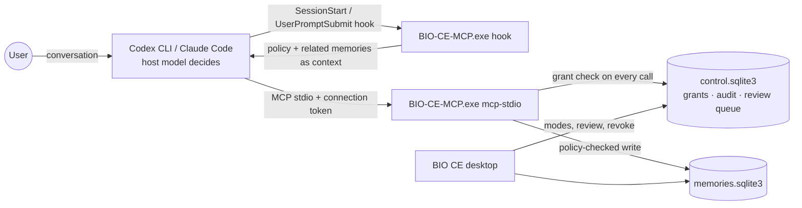

<!-- Copyright 2026 stickleetoto | Apache-2.0 -->
# BIO CE v0.3 Auto Memory

Status: development build `0.3.0.dev0` on branch `feat/autonomous-memory-v0.3`. Not released. What has and has not
been verified is listed in the [v0.3 report](release-v0.3-autonomous-memory-report.md).

Auto memory lets a connected AI host (Codex CLI or Claude Code) save and update the user's long-term memories on
its own while they work, and recall them in later sessions. It is **off by default** and turned on per host.

## How it works

1. **The host's own model decides** what is worth remembering. BIO CE makes no model call of its own and needs no
   API key. The policy it should follow reaches the model three ways: the MCP server's instructions, each tool's
   description, and (with hooks installed) the session-start context.
2. **BIO CE's server enforces** what a model cannot be trusted to follow. Every write goes through
   `bio_ce.memory_policy`, deterministically:

   | Proposal | Result |
   |---|---|
   | Contains a password, token, API/AWS/GitHub/Slack key, private key, JWT, connection string with password, resident registration number, or high-entropy token | **Refused**; the text is not stored anywhere, not even in the audit log |
   | `evidence` is `external_content` or `tool_output` | **Refused**: only what the user stated or confirmed may be stored |
   | Contains instructions aimed at an AI ("ignore previous instructions", "system prompt", "from now on you must…", Korean equivalents) | **Refused** |
   | `confidence` is `low`, a greeting/trivial text, or a question | **Refused** |
   | Same as an existing memory (normalized similarity ≥ 0.82) | **Not stored**: returns `duplicate` with the existing memory |
   | `confidence` medium, `evidence` inferred, mentions credentials, or a `correction` without a target memory | **Review queue** |
   | Update with `change_type: conflict`, or not high-confidence and user-stated | **Review queue**; nothing is overwritten |
   | Update with a stale `expected_revision_id` | **Conflict**; re-read and retry |
   | Any retraction | **Review queue**; automatic retraction is disabled |
   | More than 30 changes per hour on one connection | **Paused** for that connection |
   | Otherwise: user-stated, high-confidence, lasting fact | **Stored**, with host, connection, category, confidence, evidence and reason kept in the revision's source metadata |

3. **The user stays in control** on the Connections page: per-host access mode, session hooks, review queue
   (approve, edit and approve, reject), recent AI activity, and **Pause all AI access**.

## MCP tools

| Tool | Mode needed | Notes |
|---|---|---|
| `bio_memory_search` | Read only or Auto memory | Unchanged from v0.2 |
| `bio_memory_read` | Read only or Auto memory | Unchanged from v0.2 |
| `bio_memory_history` | Read only or Auto memory | Revisions of a current memory, oldest first |
| `bio_memory_create` | Auto memory | `title`, `content`, `category`, `confidence`, `evidence`, `reason` |
| `bio_memory_update` | Auto memory | Revision-checked (`expected_revision_id`); `change_type` = `correction`, `refinement`, or `conflict` |
| `bio_memory_retract` | Auto memory | Only files a request for the user; retraction is still not secure erasure |

Categories: `preference`, `decision`, `project_goal`, `work_context`, `correction`, `recurring_fact`.
Evidence: `user_stated`, `user_confirmed`, `inferred`, `external_content`, `tool_output`.

## Permissions and authentication

- **Modes** per connection: **Read only** (default), **Auto memory**, **Paused** (no reads or writes). Disconnect
  revokes the connection.
- **Server-side enforcement.** When the desktop app connects a host, it creates a connection ID and a random token.
  The host entry starts the server with `--connection <id>` and the token in `BIO_CE_CONNECTION_TOKEN`; only the
  token's SHA-256 is stored in `control.sqlite3`. The server authenticates at startup and **re-reads the grant on
  every tool call**, so a mode change, pause, or revocation applies to sessions that are already running.
- **Scope binding.** Each connection is bound to one project and namespace when it is created. The server and the
  hooks take the scope from the authenticated grant, tools accept calls that omit `project`/`namespace`, and any
  other scope is refused. A scope string is never used as authentication.
- **v0.2 entries** (no connection ID) keep working read-only and cannot write. The app labels them and offers
  **Reconnect**.
- **Host approvals.** Turning Auto memory on also lets the host run BIO CE's six tools without a prompt each time
  (Codex: `approval_mode = "approve"` for `mcp_servers.bio-ce.tools.<tool>`; Claude Code: `permissions.allow` entries
  `mcp__bio-ce__<tool>`). Only BIO CE's tools are affected; the file is backed up first; switching to Read only or
  Paused, or disconnecting, removes them.
- **Trust boundary.** The token sits in the host's user configuration. Any program running as the same Windows user
  can read it, and can read the SQLite files directly. These controls govern what an AI host does through BIO CE's
  tools; they are not a defense against local malware.
- **Concurrent writers.** Every write is one `BEGIN IMMEDIATE` SQLite transaction with a revision check. Two agents
  updating the same memory cannot both win: one gets `conflict`. A writer killed mid-stream leaves a consistent
  database.

## Host integration (Phase 3)

| Capability | Codex CLI 0.162 | Claude Code 2.1.306 |
|---|---|---|
| MCP server with token | `codex mcp add --env` | `claude mcp add --scope user -e` |
| Session-start context (policy + related memories) | `SessionStart` hook in `hooks.json` | `SessionStart` hook in `settings.json` (exec form) |
| Per-prompt recall | `UserPromptSubmit` hook | `UserPromptSubmit` hook |
| Hook trust | Each new or changed hook must be approved once with `/hooks` | No separate trust step |
| How the model reaches BIO tools | Function-tool models: an `mcp__bio_ce` namespace. Catalog models run in **code mode**, which shows the model neither BIO CE's tools nor its server instructions (see below) | Deferred behind `ToolSearch` (the model loads them on demand) |
| First-turn tool availability | Optional servers get `mcp_optional_startup_grace_ms` (default 1000 ms). Measured server `initialize` reply: see [Codex support](codex-support.md) | Not observed |
| Auto memory in practice | **Limited** (shown as such in the app) | **Available** (verified with a real model) |

**Connected is not the same as Auto memory available.** The Connections page shows each host's connection state
and, separately, whether its model can actually use Auto memory. Claude Code is *Available*: a real-model run saved,
deduplicated, corrected, and recalled memories. Codex CLI is *Limited*: BIO CE's server starts, lists its tools, and
executes calls, but Codex's code-mode models are not told the tools exist (an open Codex issue). Turning on Auto
memory for Codex shows this before asking for consent. Details: [Codex support](codex-support.md).

**What the hooks do.** At session start they add the BIO CE memory policy (Auto memory only), a short description
of the connection, and up to ten memories related to the working folder or most recent ones. With each prompt
they add up to three memories that share words with it, and in Auto memory mode a one-line reminder of the policy.
Context is capped at 3,500 and 1,500 characters, which bounds the extra tokens the host's model processes.
**The prompt is used only for that lookup. It is never stored, logged, or sent anywhere.** Hooks never write
memories, print nothing when the connection is paused, revoked, or misconfigured, and never block the prompt.

**Without hooks** (not installed, or not trusted in Codex), BIO CE still works through MCP, but nothing reminds
the model at session start. Whether it searches or saves then depends entirely on the model reading the tool
descriptions. Automatic recall at session start and per prompt is **not** available without hooks.

**Not done, on purpose.** BIO CE never reads the host's transcript files (`transcript_path` is ignored), never
stores raw conversation text, and makes no model calls. Any future feature that needs transcript access would need
its own explicit consent and separate verification.

## Cost boundary

BIO CE adds no paid API calls. Hook context and tool results become part of the host's normal model requests, so
they add some input tokens to the user's existing Codex or Claude usage. The per-hook character caps above keep
that bounded.

## Data

| File | Contents |
|---|---|
| `%LOCALAPPDATA%\BIO-CE\data\memories.sqlite3` | Memories (schema v1, unchanged from v0.2) |
| `%LOCALAPPDATA%\BIO-CE\data\control.sqlite3` | Connection grants (token hashes), AI write audit log, review queue |
| `%LOCALAPPDATA%\BIO-CE\connections\backups` | Copies of host settings taken before every change |

Backups made in **Settings** cover `memories.sqlite3` only; the audit log and review queue are not part of them.
